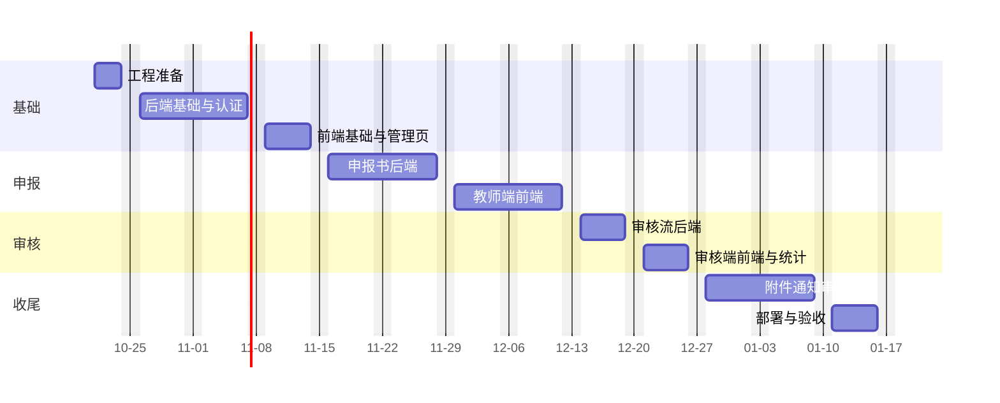

# 学院科研申报系统 — 开发计划

> 依据：[需求规格说明](requirements.md)（下文简称"需求"）及 2026-10-20 的项目现状
> 计划周期：2026-10-21 至 2027-01-15，共 63 人天（约 12.5 周）；全流程可走通（M3）在 2026-12-25
> 人力假设：1 名全栈开发，每周 5 个工作日；估算单位为人天。若有 2 人，可按第六节的并行方式压缩到约 7 周

---

## 一、现状盘点

| 部分 | 已完成 | 未开始 |
|---|---|---|
| 数据库 | 初始迁移：23 张表、10 个枚举、声明式约束、经费科目与 2026 批次种子数据；不含触发器；已在 `research_apply_db` 执行并验证 | 演示账号与部门种子数据 |
| 实体 | `sea-orm-cli` 生成的 23 个实体 | `updated_at` 写入钩子 |
| 后端 | Axum 骨架：配置、`AppError`、CORS、日志、`GET /health`、`GET /api/meta` | 认证、权限、全部业务接口、服务层校验、测试 |
| 前端 | Next.js 16 骨架：首页（读取后端状态）、申报入口、两类申报书栏目说明页、三个审核台静态页、`lib/sections.ts` 栏目定义 | 登录、表单、子表组件、审核操作、统计、管理页 |
| 工程 | `.gitignore`、`.env.example` | git 仓库、格式化与 lint 规范、本地数据库启动脚本、CI、部署配置 |

现有代码中需要先改的两处：

1. `AppError` 只能表示"服务不可用"，所有数据库错误都映射为 503，需要扩展出 400 / 401 / 403 / 404 / 409 / 422（含字段级错误）；
2. 前端 `lib/api.ts` 只有两个无鉴权的 GET 请求，需要改造成带会话的统一请求封装。

## 二、计划原则

1. **按业务链路纵向推进**：每个阶段交付一条可演示的链路（登录 → 教师填报 → 审核 → 盲审），而不是先写完所有后端再写前端。
2. **先后端、后页面**：每条链路先完成接口和服务层测试，再接页面，减少返工。
3. **规则只写一份**：服务层校验规则集中在 `services/validation`，与需求 6.3 逐条对应；前端 zod schema 按同一清单编写，联调时逐条对照。
4. **待确认事项设截止时间**：需求第十一节的问题在对应阶段开始前必须有结论，否则按本文档的默认方案实施（见第四节）。
5. **初始迁移冻结**：从阶段 1 开始，任何表结构变更都新增迁移文件。

## 三、里程碑总览

| 阶段 | 时间 | 主题 | 里程碑 |
|---|---|---|---|
| 0 | 10-21 ～ 10-23 | 工程准备 | 仓库、规范、种子数据就绪 |
| 1 | 10-26 ～ 11-06 | 后端基础设施 + 认证 + 基础数据 | **M1：五类角色可登录，管理员可维护部门、用户、批次** |
| 2 | 11-09 ～ 11-13 | 前端基础设施 + 登录 + 管理页 | 前端可登录、按角色显示导航 |
| 3 | 11-16 ～ 11-27 | 申报书后端 | 两类申报书全部栏目可通过接口保存、提交、撤回 |
| 4 | 11-30 ～ 12-11 | 教师端前端 | **M2：教师可在页面完整填写并提交两类申报书** |
| 5 | 12-14 ～ 12-18 | 审核流后端 | 三级审核、盲审、立项接口打通 |
| 6 | 12-21 ～ 12-25 | 审核端前端 + 统计 | **M3：全流程可在页面走通** |
| 7 | 12-28 ～ 2027-01-08 | 附件、通知、审计、联调加固 | 可演示版本 |
| 8 | 2027-01-11 ～ 01-15 | 部署、文档、用户验收 | **M4：上线候选** |

> 阶段 7 跨元旦假期，已预留 1.5 人天缓冲。2026 批次若需提前开放，可按第九节"最低可上线范围"裁剪，阶段 7 中的通知、截止提醒、审计查询推迟到上线后。



## 四、待确认事项与默认方案

| 编号 | 问题（需求第十一节） | 截止 | 未确认时的默认方案 |
|---|---|---|---|
| Q1 | 专家是否必须打分、是否分维度 | 12-11（阶段 5 前） | 必须打百分制总分，不分维度 |
| Q2 | 每项目几位专家、立项规则 | 12-11 | 每项目 3 位；科研处参考平均分人工决定，系统不自动判定 |
| Q3 | 科研处退回后是否重走系审核 | 11-13（阶段 3 前） | 重走系审核 |
| Q4 | 每人每批次可负责几项、参加者是否限项 | 11-13 | 负责人每批次 1 项；参加者不限 |
| Q5 | 是否对接统一身份认证 | 10-23（阶段 1 前） | 不对接，使用本地账号 |
| Q6 | 立项后是否做中期 / 结题管理 | 2027-01-08 | 本期不做 |
| Q7 | 前端会话方式（新增） | 10-23 | 见 T1-05：后端签发 JWT，写入 HttpOnly Cookie；Next.js 通过 rewrites 同源转发 `/api` |

## 五、阶段任务明细

任务编号格式 `T阶段-序号`。"依赖"列出必须先完成的任务。

完成标记在每条任务最左列：未完成是 `- [ ]`，完成后改成 `- [x]`。例如 T0-01 做完后，该格写成 `- [x]`。

### 阶段 0：工程准备（3 人天）

| 完成    | 编号    | 任务                                                                                           | 估算   | 交付物 / 验收                                                         |
| :---: | ----- | -------------------------------------------------------------------------------------------- | ---- | ---------------------------------------------------------------- |
| - [x] | T0-01 | 初始化 git 仓库，首次提交；补充根 `.gitignore`（`*.tsbuildinfo`、`.DS_Store`）                                | 0.25 | 仓库可推送到远程                                                         |
| - [ ] | T0-02 | 代码规范：`rustfmt.toml`、clippy 规则；前端 ESLint + Prettier；提交前检查脚本                                   | 0.5  | `cargo fmt --check`、`cargo clippy -D warnings`、`npm run lint` 通过 |
| - [ ] | T0-03 | 本地数据库：`docker-compose.dev.yml`（PostgreSQL 16）或 Postgres.app 安装说明；新建测试库 `research_apply_test` | 0.5  | 新成员按 README 半小时内跑起项目                                             |
| - [ ] | T0-04 | 种子数据命令 `cargo run -p research-apply-server --bin seed`：部门 3 个、五类角色演示账号各 1–2 个、开放 2026 批次     | 1    | 执行后可用演示账号登录（阶段 1 完成后验证）                                          |
| - [ ] | T0-05 | CI（GitHub Actions 或学院 GitLab）：后端 fmt / clippy / test（带 PostgreSQL service），前端 lint / build   | 0.75 | 推送后 CI 全绿                                                        |

### 阶段 1：后端基础设施、认证、基础数据（10 人天）

目标目录结构：

```text
server/src/
├── main.rs / config.rs / state.rs
├── error.rs              AppError：状态码 + 中文信息 + 字段错误
├── auth/                 password.rs（argon2）、jwt.rs、extractor.rs（CurrentUser、RequireRole）
├── dto/                  请求与响应结构，按模块分文件
├── services/             业务逻辑与事务，按模块分文件；validation/ 存放校验规则
├── routes/               只做参数解析、调用 service、返回 DTO
└── support/              分页、审计写入、时间工具
```

| 完成 | 编号 | 任务 | 估算 | 依赖 | 交付物 / 验收 |
|:---:|---|---|---|---|---|
| - [ ] | T1-01 | 重构 `AppError`：`BadRequest`、`Unauthorized`、`Forbidden`、`NotFound`、`Conflict`、`Validation(Vec<FieldError>)`、`Internal`；数据库唯一约束冲突映射为 409，其他数据库错误为 500 并记录日志 | 1 | — | 响应体 `{ "error": "...", "fields": [{ "field": "title", "message": "..." }] }` |
| - [ ] | T1-02 | 引入依赖：`argon2`、`jsonwebtoken`、`chrono`、`uuid`、`rust_decimal`、`axum-extra`（cookie）、`validator` 或自写校验 | 0.25 | — | 编译通过 |
| - [ ] | T1-03 | `updated_at` 统一写入：为实体实现 `ActiveModelBehavior::before_save`，或在 service 层提供 `touch()` 工具；写入方式写进后端 README | 0.75 | — | 更新任意记录后 `updated_at` 变化 |
| - [ ] | T1-04 | 密码哈希与校验；`POST /api/auth/login`（校验 `is_active`）、`POST /api/auth/logout`、`GET /api/auth/me`（资料 + 角色列表） | 1.5 | T1-01、T1-02 | 错误密码 401；停用账号 403 |
| - [ ] | T1-05 | JWT：有效期 8 小时；从 HttpOnly Cookie 或 `Authorization` 头读取；`CurrentUser` 提取器加载角色；`RequireRole` 路由守卫 | 1.5 | T1-04 | 无令牌 401；角色不符 403 |
| - [ ] | T1-06 | 审计写入工具 `audit::record(txn, actor, action, target, detail)`，登录成功 / 失败先接入 | 0.5 | T1-05 | `audit_logs` 有登录记录 |
| - [ ] | T1-07 | 分页与列表查询约定：`page`、`page_size`（≤ 100）、`total` | 0.25 | — | 公共结构体 |
| - [ ] | T1-08 | 部门接口：列表（公开）、增删改（admin） | 0.75 | T1-05 | 删除有用户的部门返回 409 |
| - [ ] | T1-09 | 用户接口：列表筛选（部门、角色、关键字）、新建、修改、停用、重置密码、分配角色（admin）；个人资料修改（本人） | 1.5 | T1-05 | 用户名 / 工号 / 邮箱重复返回 409 |
| - [ ] | T1-10 | 批次接口：列表、新建、修改开放时间、开放 / 关闭（research_office、admin）；`GET /api/cycles/current` | 0.75 | T1-05 | 截止早于开放时返回 422 |
| - [ ] | T1-11 | 经费科目接口 `GET /api/budget-subjects?family=` 返回树形结构 | 0.25 | — | 社科 14 项、自科 16 项 |
| - [ ] | T1-12 | 测试基建：测试库自动执行迁移、每个测试事务回滚或清表；`tower::ServiceExt::oneshot` 调用路由；认证与权限的接口测试 | 1 | T1-05 | `cargo test` 覆盖登录、401、403 |

### 阶段 2：前端基础设施、登录、管理页（5 人天）

| 完成 | 编号 | 任务 | 估算 | 依赖 | 交付物 / 验收 |
|:---:|---|---|---|---|---|
| - [ ] | T2-01 | 引入依赖：`react-hook-form`、`zod`、`@hookform/resolvers`；表格 / 弹窗等基础组件（自写或 shadcn/ui） | 0.5 | — | 编译通过 |
| - [ ] | T2-02 | `next.config.ts` 配置 rewrites，把 `/api/*` 同源转发到后端；改造 `lib/api.ts` 为统一请求函数：服务端组件转发 Cookie、错误转为 `ApiError`（含字段错误） | 1 | T1-05 | 服务端和客户端组件都能带会话请求 |
| - [ ] | T2-03 | 登录页、退出；`middleware.ts` 未登录跳转 `/login`；`/403` 页面 | 1 | T2-02 | 未登录访问任意业务页跳转登录 |
| - [ ] | T2-04 | `SiteFrame` 按角色显示导航；多角色用户可切换工作台 | 0.5 | T2-03 | 教师看不到"科研处"菜单 |
| - [ ] | T2-05 | 管理页：部门、用户（含角色分配、停用、重置密码）、批次 | 1.5 | T1-08 ～ T1-10 | 管理员可在页面完成基础数据维护 |
| - [ ] | T2-06 | 个人资料页 | 0.5 | T1-09 | 修改后新建申报书自动带出 |

### 阶段 3：申报书后端（10 人天）

| 完成 | 编号 | 任务 | 估算 | 依赖 | 交付物 / 验收 |
|:---:|---|---|---|---|---|
| - [ ] | T3-01 | 状态机模块 `services/workflow.rs`：枚举所有合法流转（需求 4.1）、每种状态允许的操作与角色；带旧状态条件的更新工具，影响 0 行返回 409 | 1 | T1-01 | 单元测试覆盖全部合法 / 非法流转 |
| - [ ] | T3-02 | 新建申报书：校验批次开放、`teacher` 角色、每批次负责项数（Q4）；从个人资料复制负责人快照 | 0.75 | T3-01 | 批次未开放返回 422 |
| - [ ] | T3-03 | 编辑权限公共检查：本人、可编辑状态、栏目与类别匹配 | 0.5 | T3-01 | 社科申报书保存 `ns-*` 栏目返回 422 |
| - [ ] | T3-04 | 栏目保存（一对一）：`cover`、`basic`、`recommender`、`ss-design`、`ss-foundation`、`ns-profile`、`ns-content`、`ns-indicators`；upsert | 1.5 | T3-03 | 每个栏目可单独保存、重复保存幂等 |
| - [ ] | T3-05 | 栏目保存（一对多，整组替换）：`members`、`ss-achievements`、`ss-outputs`、`ns-schedules`、`ns-equipments`；事务内先删后插、服务层生成序号、先校验数量上限 | 1.5 | T3-03 | 第 6 位参加者返回 422 而非数据库错误 |
| - [ ] | T3-06 | 预算保存：只接受本类别 `fillable` 科目，服务层计算父级与合计并返回；金额用字符串十进制 | 1 | T3-03 | 合计与各科目之和一致 |
| - [ ] | T3-07 | 详情接口：一次返回全部栏目；按角色裁剪（教师看不到专家身份；专家视图见 T5-05） | 1 | T3-04 ～ T3-06 | 教师调用不含任何 `reviewer_id` |
| - [ ] | T3-08 | 我的申报列表：按批次、状态筛选，分页 | 0.5 | T3-02 | — |
| - [ ] | T3-09 | 提交：需求 6.3"提交"行全部规则（关键词拆分、推荐人条件、推荐人回避、预算 > 0、批次时间，退回重报豁免截止时间）；一次返回全部字段错误；写 `submitted_at`、审计 | 1.25 | T3-04 ～ T3-06 | 每条规则至少一个失败用例 |
| - [ ] | T3-10 | 撤回：仅 `submitted` 且无系审核记录 | 0.25 | T3-09 | 已被审核后撤回返回 409 |
| - [ ] | T3-11 | 接口测试：两类申报书从新建到提交的完整用例 + 越权用例（他人申报书、非可编辑状态） | 0.75 | 以上 | CI 通过 |

推荐人条件的判定口径（"中级及以上职称""研究生及以上学历"）需要固定一份职称和学历字典，建议在 T3-09 前与科研处确认选项列表，前后端共用。

### 阶段 4：教师端前端（10 人天）

| 完成 | 编号 | 任务 | 估算 | 依赖 | 交付物 / 验收 |
|:---:|---|---|---|---|---|
| - [ ] | T4-01 | 我的申报列表：状态徽章、筛选、新建入口（按批次状态启用 / 禁用） | 0.75 | T3-08 | — |
| - [ ] | T4-02 | 编辑页框架 `/applications/[id]/edit`：按类别从 `lib/sections.ts` 生成 Tab；每个 Tab 独立保存、未保存离开提示、保存状态显示 | 1.5 | T3-04 | 切换 Tab 不丢数据 |
| - [ ] | T4-03 | zod schema：与需求 6.3 逐条对应，放在 `lib/schemas/`；后端字段错误回填到表单 | 1 | T2-02 | 前后端同一输入给出相同结论 |
| - [ ] | T4-04 | 封面、承诺、基本情况（负责人快照、关键词输入组件） | 1 | T4-02 | 关键词第 6 个禁止输入 |
| - [ ] | T4-05 | 可增删行表格组件：参加者、近五年成果、预期成果（阶段 / 最终两组）、计划进度、设备清单；达到上限禁用新增；设备金额自动计算 | 2 | T4-02 | 五个子表复用同一组件 |
| - [ ] | T4-06 | 长文本栏目：设计论证 6 节、研究基础 4 节、项目简介、研究内容；字数统计 | 1 | T4-02 | — |
| - [ ] | T4-07 | 技术经济指标表单（约 50 个数字字段，按论文 / 知识产权 / 标准 / 产业化 / 人才 / 平台分组） | 1 | T4-02 | — |
| - [ ] | T4-08 | 预算表：按科目树渲染，汇总行只读并实时求和 | 0.75 | T1-11 | — |
| - [ ] | T4-09 | 推荐人栏目：根据负责人职称、学历提示是否必填 | 0.25 | T4-04 | — |
| - [ ] | T4-10 | 提交确认（列出所有未通过的校验，点击跳转到对应 Tab）、撤回 | 0.5 | T3-09、T3-10 | — |
| - [ ] | T4-11 | 申报书只读视图 `/applications/[id]`：按纸质申报书顺序排版，供教师和审核人复用 | 0.25 | T3-07 | — |

### 阶段 5：审核流后端（5 人天）

| 完成 | 编号 | 任务 | 估算 | 依赖 | 交付物 / 验收 |
|:---:|---|---|---|---|---|
| - [ ] | T5-01 | 待办接口：按当前角色返回系审核、科研处审核、待指派、待立项、专家待评 | 0.75 | T3-01 | 系审核人只看到本部门 |
| - [ ] | T5-02 | 系审核：权限（角色 + 同部门）、四项确认、结论与意见；写 `reviews`、更新状态、审计（同一事务） | 0.75 | T5-01 | 重复审核返回 409 |
| - [ ] | T5-03 | 科研处审核：通过时填写封面编号（唯一）；退回、不通过 | 0.75 | T5-01 | 编号重复返回 409 |
| - [ ] | T5-04 | 指派专家：多选、回避负责人 / 参加者 / 推荐人、按研究专长筛选专家；首次指派改为 `expert_reviewing`；允许追加、撤销未评审的指派 | 1 | T5-01 | 指派负责人本人返回 422 |
| - [ ] | T5-05 | 专家匿名视图：独立 DTO，只含研究内容类字段；专家待评列表 | 0.5 | T3-07 | 序列化结果中不出现负责人、部门、参加者、推荐人字段（测试断言） |
| - [ ] | T5-06 | 专家提交评审：评分（Q1）、意见、结论；提交后不可修改 | 0.5 | T5-04 | 非本人指派返回 403 |
| - [ ] | T5-07 | 立项结论：所有指派已评审后才能操作；写 `concluded_*` | 0.25 | T5-06 | — |
| - [ ] | T5-08 | 审核时间线接口：按时间返回各级记录；对申请人隐藏专家身份，专家意见显示为"专家 1 / 2 / 3" | 0.25 | T5-02 ～ T5-07 | — |
| - [ ] | T5-09 | 接口测试：完整流程、退回重报、并发审核、盲审信息泄露 | 0.25 | 以上 | CI 通过 |

### 阶段 6：审核端前端与统计（5 人天）

| 完成 | 编号 | 任务 | 估算 | 依赖 | 交付物 / 验收 |
|:---:|---|---|---|---|---|
| - [ ] | T6-01 | 系审核台：待审列表、全文查看、四项确认 + 结论表单、已审列表 | 1 | T5-02 | — |
| - [ ] | T6-02 | 科研处审核台：筛选、审核与编号、指派专家弹窗、盲审汇总与立项 | 1.5 | T5-03、T5-04、T5-07 | — |
| - [ ] | T6-03 | 专家盲审台：待评列表、匿名全文、评分与意见表单 | 0.75 | T5-05、T5-06 | — |
| - [ ] | T6-04 | 审核时间线组件（教师详情页、审核页复用） | 0.5 | T5-08 | — |
| - [ ] | T6-05 | 统计接口 `GET /api/stats/overview`（按批次、类别、部门、状态的数量与申请经费）+ 看板页 | 1 | — | 数据与数据库直接查询一致 |
| - [ ] | T6-06 | 统计导出 Excel（`rust_xlsxwriter`） | 0.25 | T6-05 | — |

### 阶段 7：附件、通知、审计、联调加固（10 人天）

| 完成 | 编号 | 任务 | 估算 | 依赖 | 交付物 / 验收 |
|:---:|---|---|---|---|---|
| - [ ] | T7-01 | 附件上传 / 下载 / 删除：multipart、类型白名单（PDF / JPG / PNG）、≤ 20 MB、UUID 存储键、本地目录存储（预留对象存储接口）；下载鉴权，专家看不到签名件 | 2 | T3-03 | 超大文件返回 413 |
| - [ ] | T7-02 | 站内通知：状态变化、待办提醒写入 `notifications`；消息中心、未读角标 | 1.5 | T5-02 ～ T5-07 | 通知内容不含专家身份 |
| - [ ] | T7-03 | 截止提醒：后台定时任务（tokio interval），截止前 3 天提醒草稿负责人 | 0.5 | T7-02 | — |
| - [ ] | T7-04 | 审计：补齐全部关键动作；管理员审计查询页 | 1 | T1-06 | 需求 F-60 列出的动作均有记录 |
| - [ ] | T7-05 | 安全检查：越权矩阵测试（5 角色 × 全部接口）、盲审泄露检查、登录失败限流、请求体大小限制 | 2 | 全部接口 | 越权矩阵测试全部通过 |
| - [ ] | T7-06 | 性能与体验：列表分页、加载状态、空状态、错误提示统一；生成 500 份申报书测试数据验证列表与统计响应 < 500 ms | 1.5 | — | — |
| - [ ] | T7-07 | 缺陷修复缓冲 | 1.5 | — | — |

### 阶段 8：部署、文档、用户验收（5 人天）

| 完成 | 编号 | 任务 | 估算 | 交付物 / 验收 |
|:---:|---|---|---|---|
| - [ ] | T8-01 | Dockerfile（后端多阶段构建、前端 standalone 输出）、`docker-compose.yml`（postgres + backend + frontend + nginx） | 1.5 | 一条命令在新服务器启动 |
| - [ ] | T8-02 | 生产配置：HTTPS、JWT 密钥、数据库备份脚本（每日、保留 30 天）、日志落盘 | 1 | 恢复演练成功 |
| - [ ] | T8-03 | 使用手册：教师、系审核人、科研处、专家各一份 | 1 | — |
| - [ ] | T8-04 | 用户验收：科研处按真实流程试用，收集问题并修复 | 1.5 | 验收问题清零或确认推迟 |

### 二期（不排期）

申报书 PDF / Word 导出（对齐纸质版式）、Excel 批量导入用户、统一身份认证、同部门专家回避配置、分维度评分、中期检查与结题管理、历史年度数据导入。

## 六、两人并行方案

若有 2 名开发（后端 A、前端 B），按接口契约并行：

| 周 | A（后端） | B（前端） |
|---|---|---|
| 1 | 阶段 0 + T1-01 ～ T1-06 | 阶段 0 + T2-01，按需求第七节写接口类型与 mock |
| 2 | T1-07 ～ T1-12 | T2-02 ～ T2-06 |
| 3–4 | 阶段 3 | 阶段 4（先用 mock，第 4 周联调） |
| 5 | 阶段 5 | 阶段 6 |
| 6 | 阶段 7 后端部分（T7-01 ～ T7-05） | 阶段 7 前端部分（附件、消息中心、审计页、T7-06） |
| 7 | T8-01、T8-02、缺陷修复 | T8-03、缺陷修复；双方共同完成 T8-04 |

约束：每个阶段开始前，A 先提交该阶段的 DTO 定义（Rust 结构体 + 示例 JSON），B 据此编写 TypeScript 类型。

## 七、质量要求

### 完成标准（每个任务）

- 后端：接口有成功、校验失败、越权三类测试；`cargo fmt`、`clippy`（无警告）、`test` 通过；
- 前端：`npm run lint`、`npm run build` 通过；表单在后端返回字段错误时能正确显示；
- 涉及需求变更时同步修改 `docs/requirements.md`；
- 涉及表结构变更时新增迁移、重新生成实体、更新需求第六节。

### 测试分层

| 层 | 内容 | 工具 |
|---|---|---|
| 单元 | 状态机、校验规则、预算汇总、关键词拆分 | `cargo test` |
| 接口 | 每个路由的成功 / 失败 / 越权；完整流程 | `tower::ServiceExt::oneshot` + 测试库 `research_apply_test` |
| 端到端 | 教师提交 → 三级审核 → 立项的主流程，各角色一条 | Playwright（阶段 7 引入） |

## 八、风险与应对

| 风险 | 影响 | 应对 |
|---|---|---|
| 待确认事项迟迟没有结论 | 审核流返工 | 按第四节默认方案实施，结论变化时只调整服务层规则，表结构已预留 |
| 自然科学指标表单字段多（约 50 项） | 阶段 4 超时 | 指标表单按分组配置驱动渲染，不逐个手写 |
| 服务层规则与前端 zod 不一致 | 用户看到前后矛盾的提示 | 两边都以需求 6.3 为唯一来源；联调时逐条走查 |
| 盲审信息泄露 | 合规问题 | 专家接口使用独立 DTO；增加"序列化结果不含身份字段"的自动化测试 |
| 重新生成实体覆盖手写代码 | `before_save` 等丢失 | 手写逻辑放在 `entity` 之外，或生成后用脚本检查 |
| 申报开放时间早于计划 | 上线压力 | 阶段 7 的通知、审计查询可延后；最低可上线范围为 M3 + 附件 + 部署 |

## 九、最低可上线范围

如时间不足，以下功能必须在申报开放前完成，其余可延后：

1. 登录、角色权限、用户与批次管理；
2. 两类申报书填写、提交、撤回、退回重报；
3. 系审核、科研处审核与编号、指派专家、专家盲审、立项；
4. 附件上传（推荐人签字件）；
5. 部署与数据库备份。
