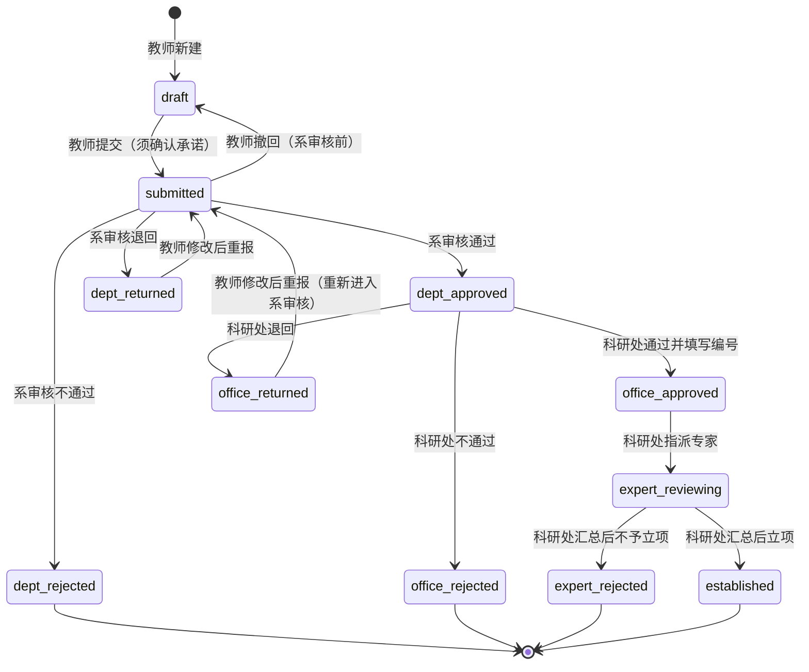

# 学院科研申报系统 — 需求规格说明

> 适用单位：黔西南民族职业技术学院 · 科研处
> 依据：附件2《2026年院级社会科学类项目申报书》、附件3《2026年院级自然科学类项目申报书》
> 技术栈：后端 Rust + Axum 0.8 + SeaORM 2.0 + PostgreSQL（`research_apply_db`）；前端 Next.js 16（App Router）+ React 19 + Tailwind CSS 4
> 数据库现状：以 `backend/migration/sql/001_up.sql` 为准，本文档第六节与其一一对应
> 设计原则：数据库不使用触发器和存储函数，只用声明式约束（主键、外键、唯一、`CHECK`、`NOT NULL`）兜底；业务规则、权限、状态流转全部在 Rust 服务层实现

---

## 一、项目背景与目标

学院每年开展院级科研项目申报，目前以 Word 申报书 + 纸质签字流转为主，存在填写不规范、流转慢、审核意见难追溯、盲审身份难隔离、统计靠手工等问题。

本系统目标：

1. 把两类申报书（社会科学类、自然科学类）的全部栏目搬到线上，结构化存储；
2. 固化"教师填报 → 系审核 → 科研处审核 → 专家盲审 → 立项"流程，每一步留痕；
3. 专家盲审时隔离申请人身份；
4. 科研处可按年度、类别、部门、状态统计申报情况。

## 二、术语

| 术语 | 含义 |
|---|---|
| 申报批次 | 一个年度的申报活动，如"2026年院级科研项目申报"，有开放/截止时间 |
| 项目类别 | A.自然科学类（`natural`）、B.社会科学类（`social`）、D."双高"校建设专项（`dual_high`）。D 类使用自然科学类申报书 |
| 申报书 | 一个项目的完整申报材料，对应 `applications` 及其子表 |
| 封面编号 | 申报书封面"编号"，申请人不填，科研处审核通过后填写（`applications.code`） |
| 负责人快照 | 申报书中负责人的性别、职称、学历等信息，从用户资料带出后存入申报书，不随资料变更 |
| 系审核 | 负责人所在系（部门）的审核，对应申报书"所在部门意见" |
| 盲审 | 专家匿名评审，专家看不到申请人身份，申请人看不到专家身份 |

## 三、角色与权限

一个账号可以有多个角色（`user_roles` 表），例如某教师同时是专家。

| 角色 | 枚举值 | 职责 | 数据范围 |
|---|---|---|---|
| 教师 | `teacher` | 创建、填写、提交、撤回本人申报书；查看审核结果与意见；退回后修改重报 | 仅本人作为负责人的申报书 |
| 系审核人 | `department_reviewer` | 对本部门已提交的申报书给出"所在部门意见"：通过 / 退回 / 不通过 | 负责人所在部门 = 本人所在部门 |
| 科研处 | `research_office` | 二级审核；填写封面编号；指派盲审专家；汇总盲审结果并决定立项；管理批次；统计 | 全院 |
| 专家 | `expert` | 对指派给自己的申报书盲审，给出意见与结论 | 仅被指派的申报书，且为匿名视图 |
| 管理员 | `admin` | 部门、用户、角色、批次等基础数据维护；可代行系审核与科研处审核 | 全院 |

权限在服务层的角色守卫和 handler 中校验，只在执行动作的那一刻检查，不绑定在历史数据上：

- 系审核：操作人必须有 `department_reviewer`（或 `admin`）角色，且与申报书的负责人所在部门相同；
- 科研处审核、填写编号、立项结论：操作人必须有 `research_office`（或 `admin`）角色；
- 专家指派：操作人必须有 `research_office` 或 `admin` 角色，被指派人必须有 `expert` 角色且账号有效；
- 专家盲审：操作人必须是该指派记录的专家本人。

数据库只兜底结构性约束，例如专家记录必须 `is_blind = true` 且必须关联指派记录（见 6.2）。

## 四、业务流程

### 4.1 总体流程

### 4.2 状态说明（`application_status`）

| 状态 | 中文 | 谁能操作 | 教师可编辑 |
|---|---|---|---|
| `draft` | 草稿 | 教师 | 是 |
| `submitted` | 已提交，待系审核 | 系审核人；教师可撤回 | 否 |
| `dept_returned` | 系审核退回 | 教师 | 是 |
| `dept_rejected` | 系审核不通过（终态） | — | 否 |
| `dept_approved` | 系审核通过，待科研处审核 | 科研处 | 否 |
| `office_returned` | 科研处退回 | 教师 | 是 |
| `office_rejected` | 科研处不通过（终态） | — | 否 |
| `office_approved` | 科研处通过，待指派专家 | 科研处 | 否 |
| `expert_reviewing` | 专家盲审中 | 专家、科研处 | 否 |
| `expert_rejected` | 不予立项（终态） | — | 否 |
| `established` | 立项（终态） | — | 否 |

规则：

- 状态流转只能由后端服务按上表执行，前端不得直接写状态；
- 每一次审核动作都在 `reviews` 表新增一条记录，历史记录不修改、不删除；
- 退回与不通过必须填写意见（数据库 `reviews_opinion_required` 兜底）；
- 首次提交和退回后重报时，服务层把 `submitted_at` 写为当前时间；
- 每次更新时服务层写入 `updated_at`（通过 SeaORM `ActiveModelBehavior::before_save` 统一处理）；
- 状态更新必须带旧状态条件，例如 `UPDATE ... WHERE id = ? AND status = 'submitted'`，影响行数为 0 时返回 409，防止重复审核。

### 4.3 批次控制

- 批次状态 `draft`（未开放）/ `open`（申报中）/ `closed`（已截止）；
- 只有 `open` 状态、且当前时间在 `opens_at` ~ `closes_at` 之间时，教师才能新建和提交申报；
- 退回重报不受截止时间限制（由科研处决定是否延长，二期可配置）；
- 迁移脚本已预置"2026年院级科研项目申报"批次，状态为 `draft`。

## 五、功能需求

### 5.1 账号与基础数据

| 编号 | 功能 | 说明 |
|---|---|---|
| F-01 | 登录 / 退出 | 用户名 + 密码，后端签发 JWT；密码 argon2 哈希存储（`users.password_hash`） |
| F-02 | 当前用户 | 返回用户资料和角色列表，前端据此显示菜单 |
| F-03 | 个人资料 | 教师维护性别、民族、出生日期、行政职务、专业技术职务、研究专长、学历、学位、手机、邮箱；作为申报书负责人信息的默认值 |
| F-04 | 部门管理 | 管理员增删改部门（名称、代码唯一） |
| F-05 | 用户管理 | 管理员新建账号、分配部门和角色、停用账号（`is_active`）、重置密码；支持 Excel 批量导入（二期） |
| F-06 | 批次管理 | 科研处 / 管理员新建批次、设置开放与截止时间、开放 / 关闭批次 |

### 5.2 教师端：申报书填写

通用要求：

- 新建时选择项目类别：B 类使用社会科学类表单，A 类和 D 类使用自然科学类表单；
- 申报书按栏目分 Tab 填写，每个栏目独立保存草稿，未填完也能保存；
- 负责人信息从个人资料带出，可在申报书内修改，修改只影响本申报书；
- 封面"编号"对教师只读；
- 只有 `draft`、`dept_returned`、`office_returned` 三种状态可编辑。

#### 5.2.1 公共栏目（两类申报书共有）

| 栏目 | 字段 | 规则 | 存储 |
|---|---|---|---|
| 封面 | 项目名称、项目类别、项目负责人、联系电话、所在部门、填表日期 | 项目名称 ≤ 40 字 | `applications` |
| 申请者承诺 | 承诺勾选 | 提交前必须勾选，记录勾选时间 | `applications.commitment_accepted(_at)` |
| 基本情况 · 负责人 | 性别、民族、出生年月、行政职务、专业技术职务、研究专长、最后学历、最后学位、手机 | — | `applications` 负责人快照字段 |
| 基本情况 · 关键词 | 关键词 | 最多 5 个，中英文分号分隔 | `applications.keywords` |
| 基本情况 · 主要参加者 | 姓名、出生年月、专业技术职务、研究专长、学历、学位、工作单位 | 最多 5 人，不含负责人；可关联系统用户 | `application_members` |
| 经费预算 | 按科目填金额（万元） | 科目由 `budget_subjects` 决定；合计由系统计算 | `application_budgets` |
| 推荐人意见 | 推荐人姓名、专业技术职务、研究专长、工作单位、推荐意见、日期 | 负责人不具备中级及以上职称且不具备研究生及以上学历时必填；推荐人不能是负责人或参加者 | `recommenders` |
| 附件 | 推荐人签字扫描件、成果证明材料等 | 文件类型：签名 / 支撑材料 / 其他 | `application_attachments` |

#### 5.2.2 社会科学类专有栏目（B 类）

| 栏目 | 内容 | 规则 | 存储 |
|---|---|---|---|
| 二、近五年相关研究成果 | 成果名称、研究者、成果形式、发表刊物或交流情况、发表出版时间 | 多行，按序号排列 | `ss_prior_achievements` |
| 三、项目设计论证 | 选题依据、研究内容、思路方法、创新之处、预期成果、参考文献 | 6 个长文本小节 | `ss_designs` |
| 四、研究基础和条件保障 | 学术简历、研究基础、承担项目、条件保障 | 4 个长文本小节 | `ss_foundations` |
| 五、预期研究成果 | 完成时间、成果名称、成果形式、负责人 | 阶段性成果 ≤ 10 项，最终成果 ≤ 2 项 | `ss_expected_outputs` |

社会科学类经费科目：直接费用（图书资料费、数据采集费、调研差旅费、设备购置和使用费、出版/文献/信息传播费、会议费、咨询费、劳务费、印刷费、其他）、间接费用（其中：绩效支出）、经费合计。

#### 5.2.3 自然科学类专有栏目（A 类、D 类）

| 栏目 | 内容 | 规则 | 存储 |
|---|---|---|---|
| 一、项目简介 | 主要研究内容与技术经济指标概述 | 长文本 | `ns_profiles` |
| 二、主要研究内容 | 目标与任务、技术难点、关键技术与创新点 | 长文本 | `ns_research_contents` |
| 三、主要技术经济指标 | 论文（国际/国内/省级/核心/一般）、报告、专著、知识产权（发明/实用新型/外观/PCT/软著/集成电路布图/植物新品种，分申请与授权）、标准（国家/行业/地方/企业，分主持与参与）、中试线、生产线、新增销售收入、新增利税、人才培养与引进、新产品/新技术/新工艺/新材料、支撑平台、试验基地、示范点、社会效益说明 | 数量为非负整数；金额单位万元，非负 | `ns_indicators` |
| 四、计划进度及目标 | 开始日期、结束日期、阶段目标 | 结束日期 ≥ 开始日期 | `ns_schedules` |
| 五、仪器设备购买清单 | 名称及规格型号、数量、单价、金额、资金来源、用途 | 只登记单价 ≥ 5000 元的设备；数量 > 0 | `ns_equipments` |

自然科学类经费科目：直接费用（设备费：购置/试制/改造与租赁；材料费；测试化验加工费；燃料动力费；差旅费/会议费/国际合作与交流费；出版/文献/信息传播/知识产权事务费；劳务费；专家咨询费；其他）、间接费用（其中：绩效支出）、经费合计。

#### 5.2.4 提交与撤回

| 编号 | 功能 | 说明 |
|---|---|---|
| F-10 | 提交 | 前后端双重校验，完整规则见 6.3；数据库 `applications_submitted_complete` 兜底检查项目名称、负责人、所在部门、承诺、提交时间 |
| F-11 | 撤回 | 仅 `submitted` 且系审核人尚未处理时可撤回为草稿 |
| F-12 | 我的申报 | 列表显示批次、类别、项目名称、状态、提交时间；可按批次和状态筛选 |
| F-13 | 审核进度 | 时间线展示每一级的审核结论和意见；专家意见匿名展示，不显示专家身份 |
| F-14 | 导出申报书 | 按纸质表格版式导出 PDF / Word（二期） |

### 5.3 系审核端

| 编号 | 功能 | 说明 |
|---|---|---|
| F-20 | 待审列表 | 本部门 `submitted` 状态的申报书 |
| F-21 | 查看全文 | 查看申报书全部栏目和附件 |
| F-22 | 审核 | 按申报书"所在部门意见"逐项确认：①申报内容是否属实 ②负责人及参加者是否适合承担本项目 ③本部门能否提供完成项目所需的时间和条件 ④本部门是否同意承担管理任务和信誉保证；给出结论（通过 / 退回 / 不通过）和意见 |
| F-23 | 已审列表 | 本人审核过的申报书及结论 |

四项确认分别存入 `reviews.facts_accurate`、`team_qualified`、`resources_ready`、`agree_to_manage`。

### 5.4 科研处端

| 编号 | 功能 | 说明 |
|---|---|---|
| F-30 | 待审列表 | 全院 `dept_approved` 状态的申报书，可按批次、类别、部门筛选 |
| F-31 | 审核 | 结论（通过 / 退回 / 不通过）+ 意见；通过时必须填写封面编号（全局唯一） |
| F-32 | 指派专家 | 对 `office_approved` 的申报书指派 1 名或多名专家，同一专家不能重复指派；可按研究专长筛选专家；指派后状态变为 `expert_reviewing` |
| F-33 | 回避规则 | 不得指派负责人本人、参加者或推荐人作为专家（应用层校验；同部门回避二期可配） |
| F-34 | 盲审汇总 | 查看各专家的评分、意见与结论，显示平均分；全部专家提交后决定立项（`established`）或不予立项（`expert_rejected`），记录结论人、结论时间和结论说明（`applications.concluded_by`、`concluded_at`、`conclusion_opinion`），结论说明对申请人可见 |
| F-35 | 统计看板 | 按批次、类别、部门、状态统计申报数量和申请经费；支持导出 Excel |
| F-36 | 批次管理 | 同 F-06 |

### 5.5 专家端

| 编号 | 功能 | 说明 |
|---|---|---|
| F-40 | 待评列表 | 指派给本人且未提交意见的申报书，只显示类别和项目名称 |
| F-41 | 匿名查看 | 只返回研究内容类栏目（设计论证、研究基础中的非身份内容、研究内容、指标、进度、设备、预算、预期成果）；不返回负责人姓名、部门、联系方式、参加者、推荐人、附件中的签名件 |
| F-42 | 提交评审 | 填写评分（0–100，可保留两位小数）、评审意见和结论（建议立项 `approved` / 不建议立项 `rejected`，专家不能"退回"），提交后不可修改。记录存入 `reviews`，通过 `assignment_id` 关联指派 |

### 5.6 站内通知

数据表 `notifications` 已建好，功能排在二期。

| 编号 | 功能 | 说明 |
|---|---|---|
| F-50 | 状态变化通知 | 申报书被提交、退回、不通过、立项时通知负责人（`status_changed`） |
| F-51 | 待办提醒 | 有新的待审申报书或专家指派时通知对应审核人和专家（`review_todo`） |
| F-52 | 截止提醒 | 批次截止前提醒仍有草稿的负责人（`deadline_reminder`） |
| F-53 | 消息中心 | 未读数角标、标记已读（写 `read_at`）、按时间倒序列表 |

通知内容不得透露专家身份。

### 5.7 操作审计

数据表 `audit_logs` 已建好，记录只追加，不修改、不删除。

| 编号 | 功能 | 说明 |
|---|---|---|
| F-60 | 记录 | 登录成功 / 失败、申报书提交 / 撤回、各级审核、指派专家、立项结论、导出、用户与角色变更。字段：操作人、动作、对象类型、对象 ID、详情（jsonb）、IP、User-Agent |
| F-61 | 查询 | 管理员按操作人、动作、时间范围查询 |

## 六、数据模型

完整定义见 `backend/migration/sql/001_up.sql`，实体由 `sea-orm-cli generate entity` 生成在 `backend/entity/src/`。

### 6.1 表清单

| 分组 | 表 | 说明 |
|---|---|---|
| 账号 | `departments` | 系 / 部门 |
| | `users` | 统一账号表，含申报书所需的个人资料 |
| | `user_roles` | 用户 × 角色，多对多 |
| 批次 | `application_cycles` | 年度申报批次 |
| 申报公共 | `applications` | 申报主表：封面、负责人快照、承诺、状态、立项结论 |
| | `application_members` | 主要参加者（≤ 5 人） |
| | `recommenders` | 推荐人（与申报书 1:1） |
| | `application_attachments` | 附件元数据（文件本体存对象存储或本地目录，`storage_key` 指向） |
| | `budget_subjects` | 经费科目字典，已预置两类申报书全部科目 |
| | `application_budgets` | 申报书 × 科目金额 |
| 社会科学 | `ss_designs` | 项目设计论证（1:1） |
| | `ss_foundations` | 研究基础和条件保障（1:1） |
| | `ss_prior_achievements` | 近五年相关研究成果 |
| | `ss_expected_outputs` | 预期研究成果（阶段 / 最终） |
| 自然科学 | `ns_profiles` | 项目简介（1:1） |
| | `ns_research_contents` | 主要研究内容（1:1） |
| | `ns_indicators` | 主要技术经济指标（1:1） |
| | `ns_schedules` | 计划进度及目标 |
| | `ns_equipments` | 仪器设备购买清单 |
| 审核 | `expert_assignments` | 盲审专家指派 |
| | `reviews` | 系审核、科研处审核、专家盲审的全部记录；专家记录含评分 |
| 通知与审计 | `notifications` | 站内通知 |
| | `audit_logs` | 操作审计，只追加；主键为自增 `bigint`，没有 `updated_at` |

共 23 张表、10 个枚举类型，不含触发器和存储函数。

### 6.2 数据库层约束（声明式，已实现）

数据库只用主键、外键、唯一、`CHECK`、`NOT NULL` 兜底。这些约束在任何写入路径下都生效，违反时服务层应已提前拦截；若仍触发，说明服务层有遗漏，按 500 记录日志。

| 规则 | 约束名 / 实现 |
|---|---|
| 项目名称 ≤ 40 字 | `applications_title_len` |
| 非草稿状态必须已填项目名称、负责人、所在部门，已确认承诺，有提交时间 | `applications_submitted_complete` |
| 勾选承诺必须有承诺时间 | `applications_commitment_time` |
| 封面编号只能在科研处审核通过及之后的状态出现 | `applications_code_after_office` |
| 立项 / 不予立项状态与结论人、结论时间同时存在 | `applications_concluded` |
| 参加者序号 1–5 且同一申报书内唯一，因此最多 5 人 | `application_members_sort_range` + `application_members_sort_unique` |
| 阶段性成果序号 1–10、最终成果序号 1–2，配合唯一约束限制数量 | `ss_expected_outputs_sort_range` + `ss_expected_outputs_sort_unique` |
| 其他子表序号 ≥ 1 且唯一 | `*_sort_range` + `*_sort_unique` |
| 设备单价 ≥ 5000、数量 > 0、金额 ≥ 0 | `ns_equipments_threshold` / `_quantity` / `_amount` |
| 进度结束日期 ≥ 开始日期；批次截止 ≥ 开放 | `ns_schedules_window`、`application_cycles_window` |
| 预算金额、指标金额非负 | `application_budgets_amount_nonnegative`、`ns_indicators_money_nonnegative` |
| 专家记录必须盲审且必须关联指派；非专家记录不能盲审、不能关联指派 | `reviews_blind_iff_expert`、`reviews_assignment_iff_expert` |
| 一条指派只对应一条评审 | `reviews_assignment_unique` |
| 评分只允许专家阶段填写，范围 0–100 | `reviews_score_expert_only`、`reviews_score_range` |
| 部门四项确认只允许系审核填写 | `reviews_department_checks_only` |
| 待审核记录没有审核时间，已审核记录必须有 | `reviews_reviewed_at` |
| 退回、不通过必须填写意见 | `reviews_opinion_required` |
| 专家不能"退回" | `reviews_expert_no_return` |
| 同一专家不能重复指派同一申报书；不能自己指派自己 | `expert_assignments_unique`、`expert_assignments_not_self` |
| 附件大小 0–20 MB，存储键唯一 | `application_attachments_size`、`application_attachments_storage_key_unique` |
| 封面编号、用户名、工号、邮箱、部门名称唯一 | 各 `*_unique` |

### 6.3 服务层校验规则

以下规则依赖跨表查询、当前登录用户或可配置参数，统一在 Rust 服务层实现。校验失败返回 422（字段错误）、403（无权限）或 409（状态冲突），错误信息用中文并指明字段。

| 场景 | 规则 |
|---|---|
| 新建申报书 | 批次为 `open` 且在开放时间内；操作人有 `teacher` 角色；负责人信息从个人资料带出 |
| 保存任意栏目 | 操作人是负责人本人；状态为 `draft` / `dept_returned` / `office_returned`；栏目与类别匹配：`ss_*` 只用于 `social`，`ns_*` 只用于 `natural` / `dual_high` |
| 保存参加者、成果、进度、设备 | 按栏目整组替换（事务内先删后插）；先校验数组长度：参加者 ≤ 5、阶段成果 ≤ 10、最终成果 ≤ 2；序号由服务层按数组顺序生成 |
| 保存预算 | 科目的 `applies_to` 与申报类别匹配；只接受 `fillable = true` 的科目；汇总行由服务层计算，不接受前端传入 |
| 保存设备 | 单价 < 5000 时提示不应列入；金额 = 数量 × 单价 |
| 提交 | 项目名称非空且 ≤ 40 字；负责人姓名、所在部门已填；已勾选承诺；关键词按中英文分号拆分后 ≤ 5 个；负责人不具备中级及以上职称且不具备研究生及以上学历时必须有推荐人；推荐人不能是负责人或参加者；预算合计 > 0；批次仍在开放期内（退回重报除外）；写入 `submitted_at` |
| 撤回 | 状态为 `submitted`，且尚无系审核记录 |
| 系审核 | 见第三节权限；状态为 `submitted`；四项确认必填；退回 / 不通过必须有意见 |
| 科研处审核 | 状态为 `dept_approved`；通过时必须填写封面编号且未被占用 |
| 指派专家 | 状态为 `office_approved` 或 `expert_reviewing`；被指派人有 `expert` 角色且账号有效；回避负责人、参加者、推荐人；首次指派时状态改为 `expert_reviewing` |
| 专家评审 | 操作人是指派的专家本人；该指派尚无评审记录；评分 0–100；结论只能是建议立项或不建议立项 |
| 立项结论 | 状态为 `expert_reviewing`；所有指派都已提交评审；写入结论人、结论时间、结论说明 |
| 通用 | 状态更新带旧状态条件；多表写入放进同一事务；每次更新写 `updated_at`；关键动作写 `audit_logs`，需要时写 `notifications` |

### 6.4 与《开发需求与开发计划》初稿的差异

初稿中的表设计已被现有 migration 取代，主要差异：

| 初稿 | 现状 | 说明 |
|---|---|---|
| `users.role` 单角色 | `user_roles` 多角色 | 教师可同时担任专家 |
| `natural_details` / `social_details` 宽表 + `jsonb` 指标 | `ns_*` / `ss_*` 按栏目拆表，指标为定长整数列 | 便于统计和约束 |
| `budget_items.subject` 存科目名 | `budget_subjects` 字典 + `application_budgets` | 科目层级、可填性由字典控制 |
| `review_assignments` | `expert_assignments` | 改名 |
| 状态 `approved` / `rejected` / `blind_review` | `established` / `expert_rejected` / `expert_reviewing`，另增 `dept_rejected`、`office_rejected` | 区分退回和不通过 |
| `reviews.score` 盲审评分 | `reviews.score numeric(5,2)`，0–100，仅专家阶段 | 同时新增 `reviews.assignment_id` 关联指派 |
| 触发器校验业务规则 | 不使用触发器 | 规则移到服务层（6.3），数据库只留声明式约束（6.2） |

### 6.5 设计变更记录

| 日期 | 变更 |
|---|---|
| 2026-10-20 | 删除全部触发器和存储函数（提交校验、参加者与成果数量、栏目与类别匹配、经费科目匹配、审核人角色、专家指派角色、`updated_at` 自动刷新），改为服务层校验；能用声明式约束表达的规则改为 `CHECK` / `UNIQUE`（见 6.2） |
| 2026-10-20 | `reviews` 新增 `score`（专家评分）和 `assignment_id`（关联指派），并增加意见必填、审核时间、阶段字段一致性等约束 |
| 2026-10-20 | `applications` 新增 `concluded_by`、`concluded_at`、`conclusion_opinion` 记录立项结论 |
| 2026-10-20 | 新增 `notifications`（站内通知）、`audit_logs`（操作审计）两张表和 `notification_kind` 枚举 |
| 2026-10-20 | `expert_assignments` 不能自己指派自己；附件大小上限 20 MB、存储键唯一；新增审核人、参加者用户、通知、审计索引 |

以上变更直接改写在初始迁移 `m20260929_000001_init_schema` 中（项目尚无数据）。今后的结构调整一律新增迁移文件，不再修改初始迁移。

## 七、接口规划

统一约定：

- 前缀 `/api`，JSON 收发，时间用 ISO 8601，金额用字符串传输的十进制数（避免浮点误差）；
- 认证：`Authorization: Bearer <JWT>`；
- 错误响应：`{ "error": "中文说明" }`，HTTP 状态码区分 400 / 401 / 403 / 404 / 409 / 422 / 500。

| 模块 | 方法与路径 | 说明 | 状态 |
|---|---|---|---|
| 系统 | `GET /health` | 健康检查（含数据库 ping） | 已实现 |
| | `GET /api/meta` | 流程步骤、项目类别、当前批次、科目数 | 已实现 |
| 认证 | `POST /api/auth/login` | 登录 | 待开发 |
| | `GET /api/auth/me` | 当前用户与角色 | 待开发 |
| 基础数据 | `GET /api/departments` | 部门列表 | 待开发 |
| | `GET /api/cycles`、`POST /api/cycles`、`PATCH /api/cycles/{id}` | 批次 | 待开发 |
| | `GET /api/budget-subjects?family=social` | 经费科目字典 | 待开发 |
| 管理 | `GET/POST /api/admin/users`、`PATCH /api/admin/users/{id}` | 用户与角色 | 待开发 |
| 申报书 | `POST /api/applications` | 新建（指定批次和类别） | 待开发 |
| | `GET /api/applications/mine` | 我的申报 | 待开发 |
| | `GET /api/applications/{id}` | 详情（按角色裁剪字段） | 待开发 |
| | `PUT /api/applications/{id}/{section}` | 分栏目保存，`section` 取 `cover`、`basic`、`members`、`recommender`、`budget`、`ss-achievements`、`ss-design`、`ss-foundation`、`ss-outputs`、`ns-profile`、`ns-content`、`ns-indicators`、`ns-schedules`、`ns-equipments` | 待开发 |
| | `POST /api/applications/{id}/submit` | 提交 | 待开发 |
| | `POST /api/applications/{id}/withdraw` | 撤回 | 待开发 |
| | `POST /api/applications/{id}/attachments`、`DELETE .../{attachment_id}` | 附件 | 待开发 |
| 审核 | `GET /api/reviews/todo?stage=department` | 待办列表 | 待开发 |
| | `POST /api/applications/{id}/reviews` | 系审核 / 科研处审核 | 待开发 |
| | `POST /api/applications/{id}/assignments` | 指派专家 | 待开发 |
| | `GET /api/expert/assignments`、`GET /api/expert/assignments/{id}` | 专家待评、匿名详情 | 待开发 |
| | `POST /api/expert/assignments/{id}/review` | 专家提交意见 | 待开发 |
| | `POST /api/applications/{id}/conclude` | 立项 / 不予立项 | 待开发 |
| 统计 | `GET /api/stats/overview` | 科研处看板 | 待开发 |
| 通知 | `GET /api/notifications`、`GET /api/notifications/unread-count` | 消息列表、未读数 | 二期 |
| | `POST /api/notifications/{id}/read`、`POST /api/notifications/read-all` | 标记已读 | 二期 |
| 审计 | `GET /api/admin/audit-logs` | 审计查询（管理员） | 二期 |

## 八、前端页面规划

| 路由 | 页面 | 角色 | 状态 |
|---|---|---|---|
| `/` | 首页：当前批次、流程说明、服务状态 | 全部 | 已有静态版 |
| `/login` | 登录 | 全部 | 待开发 |
| `/applications` | 我的申报 | 教师 | 已有静态版 |
| `/applications/social/new` | 新建社会科学类申报 | 教师 | 已有栏目说明 |
| `/applications/natural/new` | 新建自然科学类申报 | 教师 | 已有栏目说明 |
| `/applications/[id]/edit` | 分栏目填写 | 教师 | 待开发 |
| `/applications/[id]` | 申报书只读视图 + 审核时间线 | 教师、系审核人、科研处 | 待开发 |
| `/reviews/department` | 系审核待办 | 系审核人 | 已有静态版 |
| `/reviews/office` | 科研处审核、指派专家、立项 | 科研处 | 已有静态版 |
| `/reviews/expert` | 专家盲审待办与评审 | 专家 | 已有静态版 |
| `/stats` | 统计看板 | 科研处 | 待开发 |
| `/admin/*` | 部门、用户、批次管理 | 管理员 | 待开发 |

交互要求：

- 表单使用 react-hook-form + zod，校验规则与后端一致；
- 子表（参加者、成果、进度、设备）用可增删行的表格，行数达到上限时禁用新增；
- 预算表按 `budget_subjects` 渲染层级，父级和合计只读并自动求和；
- 长文本栏目显示字数，支持自动保存草稿；
- 按登录用户的角色显示导航，无权限路由跳转到 403 页。

## 九、非功能需求

| 类别 | 要求 |
|---|---|
| 安全 | 密码 argon2 哈希；JWT 有效期 ≤ 8 小时；所有接口在 handler 内校验数据归属；专家接口单独 DTO，从结构上不含身份字段；申请人接口不返回专家 `reviewer_id` |
| 一致性 | 提交、审核、指派、立项等多表写入放在同一事务；状态流转使用"带旧状态条件的 UPDATE"防止并发重复审核 |
| 审计 | 审核记录只增不改；关键操作写入 `audit_logs`；除 `audit_logs`、`user_roles` 外所有表有 `created_at` / `updated_at`，`updated_at` 由服务层写入 |
| 性能 | 单批次预计申报量 < 500 份，列表接口分页；常用查询已建索引（负责人、部门+状态、批次+类别、审核阶段、审核人、专家、未读通知、审计操作人与对象） |
| 文件 | 单个附件 ≤ 20 MB，仅允许 PDF / JPG / PNG；文件名重命名为 UUID 存储 |
| 兼容 | 前端支持 Chrome / Edge / 360 极速模式最新两个大版本，桌面端优先 |
| 部署 | docker compose：postgres + backend + frontend；后端通过环境变量配置（见 `backend/.env.example`） |
| 备份 | 数据库每日备份，保留 30 天 |

## 十、开发计划

详细计划（任务分解、估算、依赖、验收标准、风险）见 [development-plan.md](development-plan.md)。里程碑摘要：

| 里程碑 | 日期 | 内容 |
|---|---|---|
| 骨架 | 已完成 | Cargo workspace、初始迁移（23 张表、无触发器）、实体、`/health` 与 `/api/meta`、Next.js 页面骨架 |
| M1 | 2026-11-06 | 五类角色可登录，管理员可维护部门、用户、批次 |
| M2 | 2026-12-11 | 教师可在页面完整填写并提交两类申报书 |
| M3 | 2026-12-25 | 系审核 → 科研处审核 → 专家盲审 → 立项全流程可在页面走通 |
| M4 | 2027-01-15 | 附件、通知、审计、安全加固、部署完成，进入上线候选 |

## 十一、待确认事项

1. 专家评分已按百分制建了 `reviews.score`（可为空）。是否必须打分？是否需要分维度评分（如选题价值、研究基础、可行性）？若要分维度，需另建评分细则表。
2. 一个项目指派几位专家？立项按平均分、多数意见还是科研处综合决定？
3. 科研处退回后重报，是否需要重新经过系审核？（当前按"重新进入系审核"设计）
4. 每位教师每个批次可作为负责人申报几项？参加者是否限制同时参与的项目数？
5. 是否对接学院统一身份认证？
6. 立项后是否需要在本系统继续做中期检查和结题管理？
